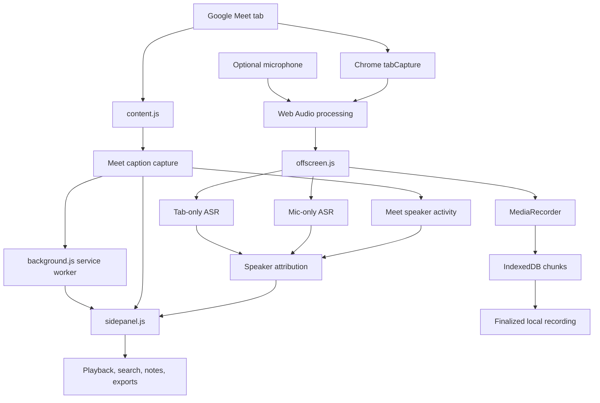

# Meet Notebook

A local-first Google Meet recorder and meeting-notes extension for Chrome. Meet Notebook records meeting audio, captures speaker-labelled Google Meet captions, and can run a second speech-recognition pass on-device to help recover words that captions miss.


## Contents

- [What it does](#what-it-does)
- [How transcription works](#how-transcription-works)
- [Features](#features)
- [Requirements](#requirements)
- [Install and get started](#install-and-get-started)
- [Using Meet Notebook](#using-meet-notebook)
- [Architecture](#architecture)
- [Project structure](#project-structure)
- [Privacy and participant consent](#privacy-and-participant-consent)
- [Accuracy and known limitations](#accuracy-and-known-limitations)
- [Development and tests](#development-and-tests)
- [Troubleshooting](#troubleshooting)
- [Release notes](#release-notes)

## What it does

Meet Notebook is designed to keep meeting capture and notes in your browser:

- Record Google Meet tab audio, with optional microphone audio.
- View live meeting captions in a Chrome side panel, retaining participant names supplied by Meet.
- Optionally transcribe the separate tab audio and microphone audio using Chrome's on-device Speech Recognition API.
- Pause, resume, stop, and play back finalized recordings.
- Search the transcript, add manual notes, and export meeting content.
- Configure microphone input and sensitivity, recording quality, theme, language, and transcription options.

The extension is built with Chrome Extension Manifest V3 and uses browser APIs such as tab capture, offscreen documents, the Side Panel API, and IndexedDB.

## How transcription works

Meet Notebook uses two complementary sources. They are intentionally shown as separate transcript sources because they provide different information.

### 1. Google Meet captions

The content script observes individual Google Meet caption cards, extracts the speaker label from card text or accessible metadata, and sends each utterance with its speaker identity. Card parsing excludes shared wrapper nodes so separate remote participants are not combined into one transcript entry.

**Speaker names come from Google Meet captions.** The extension does not claim that it can identify every speaker from a mixed audio recording.

### 2. Optional local audio recognition (on-device)

When enabled and supported, Chrome's local Speech Recognition API runs two independent recognizers:

- **Tab channel:** receives only Google Meet tab audio, containing remote participants.
- **Microphone channel:** receives only the local microphone signal, attributed to the configured name in Settings.

The mixed audio track is reserved for the recording. It is never sent to the recognizer. Meet caption activity timestamps associate tab-channel speech with the dominant non-self caption speaker active near that utterance. The attribution window is deliberately narrow; when multiple speakers are equally plausible, the extension labels the audio **Unattributed audio** rather than inventing a participant name. Participant names always come from Meet captions; audio attribution remains best-effort when captions are delayed or participants interrupt one another.

- Recognition uses processLocally = true.
- Local ASR is optional. A missing or unavailable language model does not prevent Start, recording, or Meet-caption capture.
- ASR segments use channel/session/result identifiers, and interim text is finalized when recognition ends or recording pauses/stops.
- Audio segments substantially covered by a same-speaker Meet caption are hidden from the visible transcript to avoid duplicate lines. Uncovered audio text is retained under the inferred speaker.
- Microphone segments use the local name from Settings. If no nearby speaker activity is sufficiently clear, the fallback is **Unattributed audio**; the extension does not guess a person's name.

The recognizer requests up to three hypotheses and selects the highest-confidence alternative. Tab audio is conditioned with a speech-focused high-pass/low-pass filter and dynamic-range compression before recognition. The conversation, dictation, and command tiers are Chrome model quality options. Command is a basic phrase model and is not recommended for continuous meeting transcription. Model availability varies by Chrome version, device, language, and policy.

### Speech model quality matters

Chrome's model availability varies by Chrome build, operating system, device, language, and policy settings. The quality tiers are not equivalent:

| Tier | Intended use | Meeting suitability |
|---|---|---|
| `conversation` | Continuous speech with multiple primary speakers | Preferred when available |
| `dictation` | Continuous speech from one primary speaker | Best-effort fallback |
| `command` | Short phrases and commands | Basic fallback; not meeting-grade |

The extension reports the tier installed on the current device. A successful installation does not guarantee high-quality recognition. Refer to the [MDN SpeechRecognition.install() documentation](https://developer.mozilla.org/en-US/docs/Web/API/SpeechRecognition/install_static) for browser API details.

## Features

### Recording and playback

- Captures Google Meet tab audio and optional microphone audio.
- Mixes audio through a 48 kHz Web Audio pipeline.
- Includes microphone gain controls and optional voice enhancement (noise filtering/compression).
- Uses MP4 (H.264/AAC) when supported by the browser; otherwise uses WebM (VP8/Opus).
- Writes one-second media chunks to IndexedDB during recording.
- Keeps the finalized recording locally for playback and seeking in the side panel.
- Pausing recording also pauses the local audio recognizer; recognition resumes with recording.

### Live notebook

- Chrome side panel with Live notes, Past meetings, and Settings views.
- Live transcript display with speaker labels and source distinction.
- Transcript search.
- Manual meeting notes.
- TXT, Markdown, and JSON export options, plus copy controls.
- Recording state, elapsed timer, and audio-level indicators.

### Audio and settings

- Select a microphone device and test its input level.
- Configure microphone sensitivity and automatic gain/voice enhancement options.
- Select the language used for local audio transcription.
- Install/check the local speech model from Settings.
- Choose recording quality and light, dark, or system theme.
- Optionally hide Meet captions on the meeting screen while retaining them in the notebook.

## Requirements

- **Google Chrome 139 or newer.**
- A desktop environment with Chrome extension support.
- Google Meet at [meet.google.com](https://meet.google.com/).
- Microphone permission if you want your own microphone included in the recording.
- For independent local audio transcription: a supported Chrome on-device Speech Recognition implementation and an installed language model for the chosen language.

No Python, FFmpeg, API key, local server, external account, or paid transcription service is required.

> **Important:** Installing a local Chrome language model is optional. If it cannot be installed, Start still records the meeting and captures Meet captions; only supplementary local ASR is unavailable.

## Permissions explained

The extension requests the following Chrome permissions to support its recording and notebook workflow:

| Permission | Why it is needed |
|---|---|
| `tabCapture` | Captures audio from the active Google Meet tab after you start a recording. |
| `offscreen` | Runs media capture, audio processing, and recording work outside the service worker. |
| `downloads` | Saves transcript exports and the finalized transcript file to your Downloads location. |
| `activeTab` | Accesses the tab you explicitly interact with when starting a recording. |
| `storage` | Stores extension settings and recording/session state. |
| `scripting` | Injects the caption-capture content script when it needs to be re-established in a Meet tab. |
| `sidePanel` | Displays the Meet Notebook interface in Chrome's side panel. |
| `unlimitedStorage` | Allows larger locally stored meeting data within browser storage limits. |

The host permission is restricted to `https://meet.google.com/*`; the extension does not request general access to every website.

## Install and get started

### Load the extension

1. Clone or download this repository.
   ```bash
   git clone https://github.com/angadkumar9128/meet-recorder-extension.git
   ```
2. Open `chrome://extensions` in Chrome.
3. Enable **Developer mode**.
4. Select **Load unpacked**.
5. Choose the repository folder containing `manifest.json`.
6. Pin or open **Meet Notebook** from the Chrome toolbar. You can also use **Alt+Shift+N** (the default `open-notebook` shortcut; customize it at `chrome://extensions/shortcuts`).

### Optional: prepare local transcription

1. Open a Google Meet meeting or create a test meeting.
2. Open the Meet Notebook side panel and select **Settings**.
3. Choose the language spoken in the meeting.
4. Click **Install / check local speech model**.
5. Wait for the status message to confirm the installed language and quality tier.
6. Enable **Live Meeting Transcription (on-device)** and save settings. This step is optional; recording and Meet captions work without it.

The model download is a one-time setup per supported language/device environment. Chrome controls which models are available. If installation reports downloadable or fails, you can still start a recording.

### Start a recording

1. Open the target Google Meet tab and turn on captions in Meet.
2. Open Meet Notebook from the toolbar or side panel.
3. Set your display name in the extension settings if desired.
4. Select **Start**.
5. Grant microphone permission when prompted if your own microphone should be recorded.
6. Use **Pause**, **Resume**, and **Stop** from the notebook controls.
7. After finalization, use the playback panel to review and seek through the recording.

You can also start and stop from the extension popup. The popup provides a shortcut to microphone setup and a caption-diagnostics copy action.

## Using Meet Notebook

### Live notes

The Live notes view displays incoming transcript entries. Meet captions retain their speaker attribution; the local audio source is identified separately. Use the search field to find words or speaker names and the note field to add your own observations.

### Past meetings and exports

Use Past meetings to browse locally saved sessions. Transcript export controls support:

- **TXT** — readable speaker-labelled text.
- **MD** — Markdown meeting notes.
- **JSON** — structured transcript data.

The exact content of an export depends on the data captured in that session. Review exported material before sharing it. Exports are generated as local downloads; the extension does not upload them to a meeting-notes service.

### Microphone setup

Open **Test microphone / grant access** in Settings. Select the desired input device, start the level test, and speak at normal meeting volume. The input meter should respond consistently. Microphone sensitivity and enhancement settings affect the recorded microphone audio; they do not change Google Meet's caption engine.

## Architecture

Meet Notebook is a browser extension with a service worker, a Meet content script, an offscreen recording/transcription document, and a side-panel UI.



### Main components

| Component | Responsibility |
|---|---|
| `manifest.json` | Manifest V3 metadata, permissions, service worker, side panel, command, and Meet content-script registration |
| `background.js` | Extension service worker; coordinates recording lifecycle, messages, session state, and downloads |
| `content.js` | Reads Google Meet caption updates and sends transcript/diagnostic messages |
| `offscreen.html`, `offscreen.js` | Offscreen media capture, Web Audio processing, MediaRecorder, local audio recognition, and recording persistence |
| `sidepanel.html`, `sidepanel.css`, `sidepanel.js` | Notebook interface, transcript display, settings, session browsing, playback, notes, and exports |
| `popup.html`, `popup.js` | Toolbar popup controls for quick start/stop and diagnostics |
| `setup.html`, `setup.js` | Microphone permission, input selection, and input-level test |
| `lib/transcript.js` | Shared transcript upserts, Meet/audio coverage deduplication, speaker attribution, rolling-caption handling, and export-turn formatting |
| `lib/asr-channel.js` | Independent tab/microphone recognizer lifecycle, session-safe result IDs, partial finalization, and restart handling |
| `tests/`, `lib/transcript.test.js` | Regression tests for transcript merging and deduplication |

## Project structure

```text
meet-recorder-extension/
├── .github/
│   └── workflows/
│       └── extension-checks.yml
├── lib/
│   ├── asr-channel.js
│   ├── transcript.js
│   └── transcript.test.js
├── tests/
│   ├── asr-channel.test.js
│   ├── local-asr-dedupe.test.js
│   ├── speaker-attribution.test.js
│   └── transcript-merge.test.js
├── background.js
├── content.js
├── manifest.json
├── offscreen.html
├── offscreen.js
├── popup.html
├── popup.js
├── setup.html
├── setup.js
├── sidepanel.css
├── sidepanel.html
├── sidepanel.js
└── README.md
```

## Privacy and participant consent

Meet Notebook is designed for local-first use:

- The independent speech recognizer is explicitly configured for on-device processing.
- Meeting audio and transcripts are not sent to an external transcription API or server by this extension.
- Audio chunks and finalized recording media are stored in the browser's IndexedDB database (`meet-notebook-media`); meeting sessions/transcripts and extension settings use Chrome extension storage.
- Transcript export files are created through Chrome's Downloads API when you request an export or stop a recording.
- Google Meet captions are still provided by Google Meet itself; their availability and processing are subject to Google's service.
- Installing a Chrome speech model requires Chrome to obtain the relevant language resources. This is separate from sending each meeting's audio to a transcription service.

**Always tell every participant before recording.** Obtain any consent required by applicable law, workplace policy, and the meeting organizer. Do not record meetings without authorization.

## Accuracy and known limitations

- Google Meet captions are the primary source for participant names and speaker-labelled words. The extension reads the caption UI; if Meet does not expose a caption card or speaker label, no browser extension can reliably infer that participant's name from a single mixed tab-audio stream without a dedicated diarization model.
- Chrome on-device speech recognition is a best-effort secondary source. Multiple hypotheses and voice-focused audio conditioning can help, but no local browser model guarantees a verbatim transcript. Accuracy depends on language/model quality, microphone quality, accents, crosstalk, background noise, and network/Chrome behavior.

Meet Notebook aims to improve transcript coverage, not guarantee a perfect transcript.

- Meet captions are the source of participant names. Tab-audio speaker attribution is inferred from nearby caption activity and can be ambiguous during overlap or delayed captions; microphone audio is attributed to the configured local user.
- Accuracy depends on language-model support, model quality, microphone/speaker volume, echo, noise, overlapping speech, accents, and audio quality.
- Language switching, uncommon names, specialist terminology, interruptions, and multiple people speaking at once can cause errors or omissions.
- The `command` quality tier is designed for short phrases and should not be treated as a meeting-grade model.
- Recognition sessions can restart after recoverable errors. The extension attempts to preserve the last interim phrase as a marked partial entry, but it may be incomplete.
- Duplicate suppression merges exact repeats, rolling prefixes, word-boundary overlaps, and substantial shared phrases when Meet recreates a caption card with a short changed lead-in. Short common openings alone are not enough to merge separate speech.
- Browser support and local model availability can change across Chrome versions, platforms, and managed-device policies.
- No missed-word-free or word-perfect transcript can be guaranteed.

For best results, keep the Meet tab open, enable Meet captions, select the same language in Meet and Meet Notebook, use a clear microphone, and reduce background noise and speaker echo.

## Development and tests

The extension has no build step. Load the repository folder directly as an unpacked extension.

Use Node.js to run the syntax checks and transcript regression tests:

```bash
node --check background.js
node --check content.js
node --check offscreen.js
node --check sidepanel.js
node --check setup.js
node --test
python -c "import json; json.load(open('manifest.json', encoding='utf-8'))"
```

The test suite covers rolling Meet-caption updates, corrected caption tails, speaker-turn formatting, cumulative local-ASR snapshots, duplicate suppression, and protection against merging genuine repeated phrases.

GitHub Actions runs the repository's extension checks on pushes and pull requests (see `.github/workflows/extension-checks.yml`).

## Troubleshooting

| Problem | Things to check |
|---|---|
| Extension does not appear or load | Confirm Developer mode is enabled and the selected folder contains `manifest.json`; inspect errors on `chrome://extensions`. |
| Start says to open Meet first | Open a tab whose URL starts with `https://meet.google.com/` and retry. |
| No Meet caption transcript | Turn on captions in Meet, reload the Meet tab after installing/updating the extension, and retry. |
| Microphone is missing | Open microphone setup, grant Chrome permission, select the correct input, and check operating-system microphone permissions. |
| Local model cannot be installed | Recording and Meet captions still work. Check Chrome version, selected language support, available disk space, network access, and device/organization policy restrictions if you want supplementary local ASR. |
| Local transcript is unavailable or low quality | Check the reported model tier. `command` is only a basic fallback; use a device/language that supports `conversation` or `dictation` when possible. |
| Some words are missing or repeated | Check audio levels, echo, background noise, overlapping speech, and recognizer quality. Some omissions and recognition errors are expected. |
| Recording cannot be played immediately | Wait for the recording to finalize; playback is available after finalization. |

For caption-capture debugging, use **Copy caption diagnostics** from the popup or Settings and share only sanitized diagnostics. Caption HTML may contain meeting content and participant information.

## Release notes

### 1.7.5 — Improve audio-backup speaker attribution

- Matches tab-audio ASR segments against Meet speaker-activity samples across the segment's full time range instead of only its midpoint.
- Keeps ambiguous overlaps labelled as unattributed rather than guessing a participant.
- Adds regression tests for long ASR segments, out-of-window activity, and overlapping speakers.
- Bumps the content-script instance token so the updated attribution logic is loaded after refreshing the Meet tab.


### 1.7.4 — Deduplicate repeated Meet caption snapshots

- Detects rolling caption corrections that repeat a substantial phrase after a short changed lead-in (for example, when Meet changes the opening words as it replaces a caption card).
- Keeps the earlier short lead-in and uses the newer caption from the shared phrase onward, avoiding repeated sentence fragments while retaining genuinely new speech.
- Adds regression tests for the reported repeated-caption pattern and for distinct sentences that share only a short opening.
- Bumps the content-script instance token so Chrome loads the updated transcript logic after the Meet tab is refreshed.

### 1.7.3 — Select the active Meet captions region

- Scores all matching caption regions and observes the region containing the actual Meet caption cards instead of blindly selecting the first matching region.
- Avoids attaching to empty or inactive caption regions when Meet keeps more than one captions container in the DOM.


### 1.7.1 — Fix current Meet caption card detection

- Accepts the confirmed `.nMcdL` card shape when `.NWpY1d` and `.ygicle` are present, without requiring `innerText` to split into multiple lines or generic metadata to be present.
- Bumps the content-script instance token so an updated extension can replace an already injected script after the Meet tab is refreshed.


### 1.5.8 — Caption compatibility and interim live audio

- Restores fallback discovery for Meet caption regions/cards that do not expose stable `data-*` or ARIA card attributes.
- Publishes replaceable interim on-device audio transcript segments while speech is being recognized, then promotes them to final entries.
- Retains the distinction between speaker-attributed Meet captions and the independent mixed-audio backup.

### 1.5.7 — Speaker-labelled Meet caption cards

- Parses Meet caption cards independently rather than depending exclusively on avatar-image ancestry or shared wrapper nodes.
- Prefers accessible speaker metadata and stable speaker IDs when available.
- Uses `Speaker N` only when a caption card exposes a stable speaker ID without a readable name; it never invents speaker identity for the mixed audio stream.
- Displays source labels distinguishing Meet captions from the independent audio backup.
- Expands sanitized diagnostics to retain useful speaker/card metadata while redacting transcript text.

### 1.5.6 — Resilient local transcription and conservative deduplication

- Uses **Live Audio Transcript** as the UI label for the independent audio source.
- Preserves the latest interim phrase as a marked partial segment when a recognizer session ends.
- Restarts after recoverable recognition errors with bounded exponential backoff; terminal permission/language errors stop with an actionable status.
- Reports the actual quality tier and warns when only command quality is available.
- Uses conservative local-ASR deduplication and suppresses exact nearby Meet/audio duplicates.
- Fixes loading of the saved Meet-caption visibility setting in Settings.

### Earlier releases

- **1.5.5** — Probes conversation, dictation, and command model qualities and installs the highest available tier.
- **1.5.4** — Adds conversation-quality local speech model installation checks and more actionable diagnostics.
- **1.5.3** — Improves long rolling-result continuity across recognizer restarts.
- **1.5.2** — Fixes speech-model installer activation and ASR snapshot merging.
- **1.5.1** — Adds visible model-installation status and fixes repeated-result/stop-handler issues.
- **1.5.0** — Introduces independent on-device audio transcription alongside Meet captions.
- **1.4.3** — Improves cumulative caption snapshot handling when Meet recreates caption DOM cards.
- **1.4.2** — Improves live caption reliability and rolling-caption updates.

---

**Repository:** [angadkumar9128/meet-recorder-extension](https://github.com/angadkumar9128/meet-recorder-extension)


### 1.6.0 — Speaker-aware, non-blocking local transcription

- Isolates tab audio and microphone audio for separate local recognizers; the recording mix is never used for ASR.
- Uses Meet caption activity timestamps to attribute remote ASR segments, and the configured name for microphone segments.
- Uses stable caption IDs and incremental upserts so content-script updates cannot erase previously saved captions.
- Local speech-model checks are no longer a prerequisite to Start. Model installation uses `processLocally: true` and waits for a downloading model to finish.
- Recognizer result IDs include channel and session identity; interim results are finalized at pause/stop/end and normal restarts do not add a fixed delay.


### 1.7.2 — Restore legacy Meet caption block detection

- Search Meet `.nMcdL` caption cards at any nesting depth.
- Restore the original speaker-avatar ancestor fallback for caption block detection.
- Accept valid participant names that end with punctuation.
